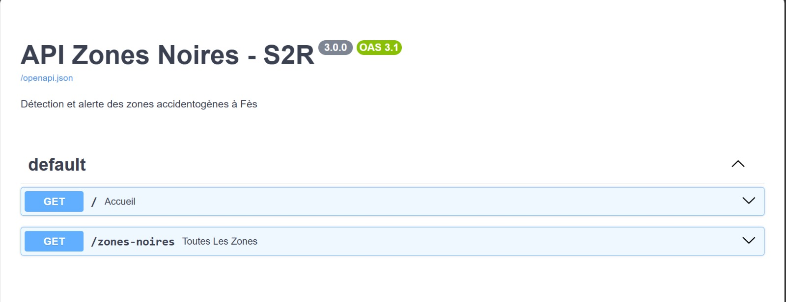
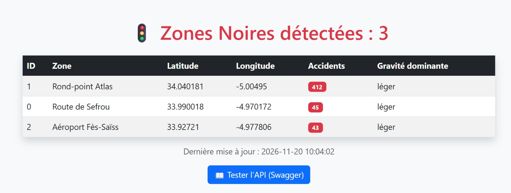
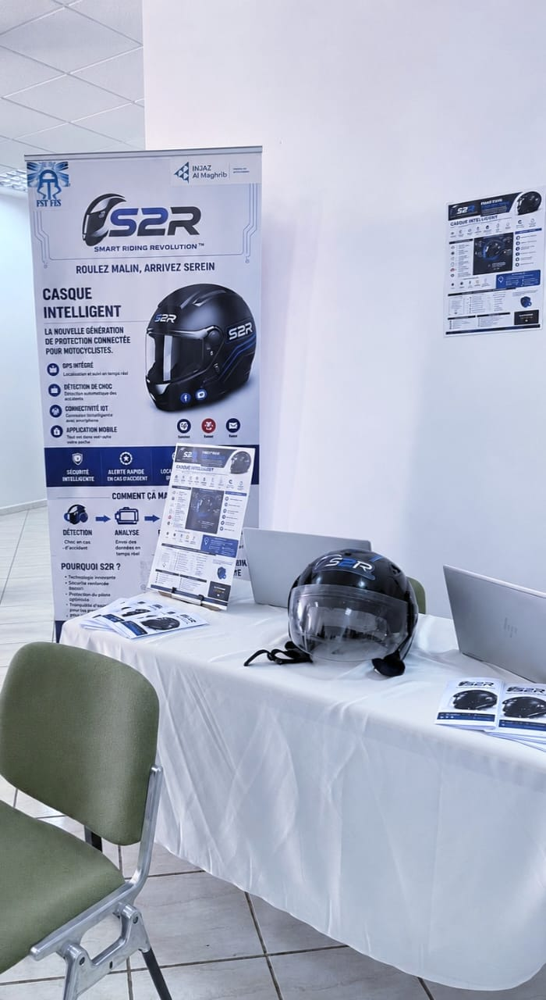

# API Zones Noires : détection des zones accidentogènes à Fès

API FastAPI qui repère les zones accidentogènes de Fès à partir d'un jeu de données d'accidents, par regroupement spatial (DBSCAN). Elle a été conçue comme brique du projet S2R (casque intelligent) : l'idée est de comparer la position d'un conducteur à ces zones pour anticiper un risque.

> **Données simulées.** Le fichier `accidents_fes.csv` est généré par `generer_data.py` (500 accidents fictifs répartis autour de lieux réels de Fès). Il ne s'agit pas de statistiques officielles.

## Fonctionnement

1. Lecture des accidents (latitude, longitude, gravité, date, vitesse, météo).
2. Regroupement spatial avec **DBSCAN** et la distance de **haversine** (distance sur la sphère terrestre).
3. Une zone noire est un groupe d'au moins **5 accidents** dans un rayon d'environ **50 m**.
4. Pour chaque zone : nom le plus fréquent, position moyenne, nombre d'accidents et gravité dominante.

Paramètres dans `main.py` :

| Paramètre | Valeur | Rôle |
|---|---|---|
| `SEUIL_ZONE_NOIRE` | 5 | Nombre minimal d'accidents pour former une zone |
| `RAYON_CLUSTER_M` | 50 m | Rayon de regroupement |
| `RAYON_ALERTE_M` | 300 m | Rayon d'alerte (défini, pas encore utilisé) |

## Endpoints

| Méthode | Chemin | Contenu |
|---|---|---|
| GET | `/` | Page HTML récapitulant les zones noires |
| GET | `/zones-noires` | Les zones au format JSON |
| GET | `/docs` | Documentation interactive (Swagger) |



## Lancer en local

```bash
pip install -r requirements.txt
uvicorn main:app --reload
```

Puis ouvrir http://127.0.0.1:8000 ou http://127.0.0.1:8000/docs.

Pour régénérer les données simulées :

```bash
python generer_data.py
```

## Déploiement

`start.sh` lance l'API avec le port fourni par la plateforme (`$PORT`), ce qui permet un déploiement sur Render ou un service similaire.

```bash
bash start.sh
```

Démo en ligne : https://zones-noires-api-1.onrender.com


## Limites

- Les accidents sont simulés : les zones trouvées reflètent la simulation, pas la réalité de la circulation à Fès.
- Le jeu de données est petit (500 lignes) et sur 18 mois.
- Le rayon d'alerte (300 m) est défini mais n'est pas encore utilisé par l'API.
- Le calcul est fait au démarrage : les zones ne se mettent pas à jour tant que le service n'est pas relancé.

## Équipe

Projet S2R (Smart Riding Revolution)


Mon rôle : département financier de la junior-entreprise, et appui sur la partie IA, en particulier le module des zones noires.
